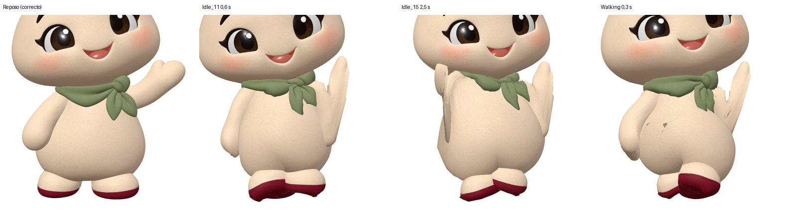
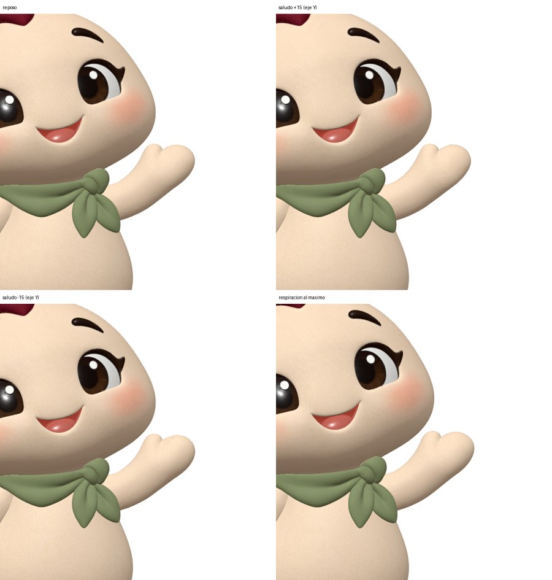
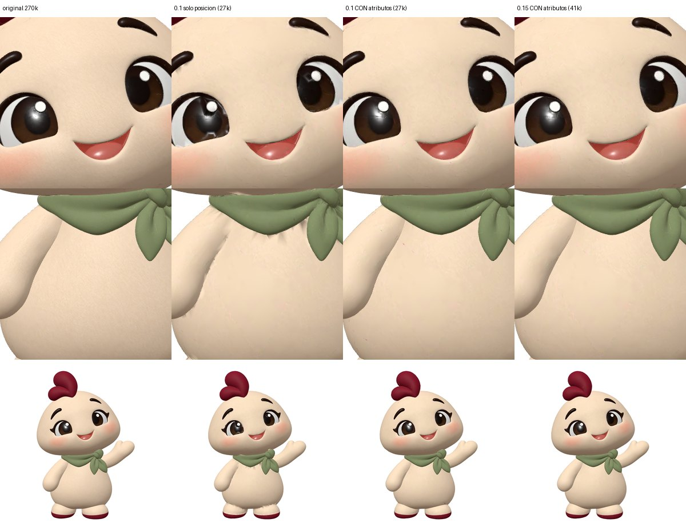

# 09 · Modelo 3D real (Meshy): análisis, validación y optimización

Fase 2. Fecha del análisis: 6-nov-2026.

## 1. Origen y copia original

| | |
|---|---|
| URL | <https://referencehome.es/images/rufi/rufianimado.glb> |
| Respuesta | HTTP 200, 34 061 136 bytes, `last-modified` 6-nov-2026 14:49 GMT. **Sin cabecera `Content-Type`** (debería ser `model/gltf-binary`; ver `10-reutilizar-en-landings.md`) |
| Formato | GLB 2.0 válido (firma `glTF`, versión 2, longitud correcta), generado por *Khronos glTF Blender I/O v4.5.51* |
| SHA-256 | `df02630d9afe795f0e295739394c1da76bb9fc4d834f170f90372f7385996b20` |
| Copia intacta | `models/original/rufianimado.glb` (en **Git LFS**) |

## 2. Qué contiene (verificado con `node tools/inspect-model.mjs`)

| Elemento | Original |
|---|---|
| Mallas | 1 (`Mesh_0`), 146 758 vértices, **270 410 triángulos** |
| Esqueleto | **Mixamo**, 24 huesos: `Hips, Spine, Spine1, Spine2, Neck, Head, HeadTop_End, headfront`, hombro/brazo/antebrazo/mano ×2, muslo/pierna/pie/punta ×2 |
| Shape keys | **Ninguna** |
| Material | 1 (`Material_0`), PBR, doble cara. Metal ≈ 0 (no metálico, correcto); rugosidad media ≈ 0,61 (algo más brillante que el 0,85–0,95 propuesto para fieltro) |
| Texturas | JPEG: color 4096², normales 4096², metal/rugosidad 2048² → **19,4 MB de los 33 MB** |
| Animaciones | `Running` 0,63 s · `Walking` 1,03 s · `Idle_11` 1,87 s · `Idle_15` 7,00 s. 24 huesos con rotación y traslación |
| Dimensiones | 1,65 m de alto (el contrato usa 1,0 m), mira a +Z |
| Pose de reposo | **La pose de la imagen oficial** (brazo izquierdo saludando) |

**Idle_11, Idle_15, Walking y Running: los cuatro están presentes** (comprobado leyendo el GLB, no supuesto).

El aspecto en reposo es fiel a Rufi: cresta de dos lóbulos granate, pañuelo verde con el nudo en el lado izquierdo del personaje, ojos con brillo, rubor, manos sin dedos, suelas granate.

## 3. Problemas encontrados

### 3.1 Las animaciones deforman a Rufi



En las cuatro animaciones el brazo que saluda se convierte en una «aleta» plana y estirada, el otro brazo también se aplasta (`Idle_15`) y se abren grietas en la barriga (`Walking`).

Medición objetiva: se comparan las aristas de cada triángulo con su longitud en reposo, en 8 fotogramas por clip (40 000 triángulos muestreados). El reposo frente a sí mismo da exactamente 1,0, lo que calibra la medida.

| Clip | Estiramiento máximo | Percentil 99,9 |
|---|---|---|
| Running | 70× | 9,7× |
| Walking | 89× | 12,0× |
| Idle_11 | 74× | 8,8× |
| Idle_15 | 72× | 9,6× |

Causa (verificada):

1. **La pose de unión (bind pose) es la del saludo**, no una T-pose/A-pose. Las animaciones de Mixamo están pensadas para un humanoide con los brazos en otra posición y empujan los brazos a posiciones imposibles. Los dos brazos tienen además longitudes distintas (14,6 frente a 22,8 unidades).
2. **Pesos automáticos defectuosos**: la cabeza tiene peso de la mano y del antebrazo izquierdos; la barriga, de los muslos. Moviendo **solo** la mano ±8° ya se deforman triángulos de la cabeza.
3. **Pie derecho mal colocado** (x = −0,294 frente a +0,129 del izquierdo).
4. Las traslaciones de los clips coinciden con las del reposo (salvo `Hips`): **no** son la causa.

Ni siquiera conservando solo la columna de los idles se obtiene un movimiento limpio (estiramiento máximo de 6,7× a 9,9×).

### 3.2 Saludo y respiración

El modelo **no trae** clips de saludo ni de respiración: el saludo es la pose de reposo. Se probaron movimientos creados sobre su propio esqueleto (no incluidos en el GLB; disponibles en el visor como «pruebas de esqueleto»):

| Prueba | Resultado |
|---|---|
| Respiración (escala ±2 % en `Spine1`/`Spine2`) | **Limpia**: percentil 99,9 = 1,09×, sin defectos visibles |
| Saludo (antebrazo y mano ±12°) | Movimiento muy sutil y pequeña marca en la mano; con más amplitud se estira la piel de la cabeza por los pesos |



Conclusión: **el esqueleto se puede controlar, pero hay que rehacer los pesos** para que el saludo sea limpio.

## 4. Validación contra el contrato de la fase 1

`node tools/validate-glb.mjs`:

| Requisito | Original | Optimizado |
|---|---|---|
| GLB 2.0 válido | ✅ | ✅ |
| Extensiones permitidas | ✅ (ninguna) | ✅ (`EXT_meshopt_compression`, `KHR_mesh_quantization`, `EXT_texture_webp`) |
| Skin / esqueleto | ✅ 24 huesos (≤ 40) | ✅ |
| Nombres de huesos del contrato | ❌ Mixamo (correspondencia en `spec/rig-mapping-mixamo.json`); faltan cresta, ojos, cejas y pañuelo | ❌ |
| Mesh `RUFI_Head` con 18 shape keys | ❌ sin shape keys | ❌ |
| 14 clips obligatorios | ❌ ninguno (tiene Running, Walking, Idle_11, Idle_15) | ❌ |
| Triángulos ≤ 30 000 | ❌ 270 410 | ✅ 27 040 (objetivo 15 000: aviso) |
| Tamaño ≤ 1 500 KB | ❌ 33 263 KB | ✅ **697,7 KB** (objetivo ≤ 800 KB) |
| Texturas ≤ 1024 px | ⚠️ 4096 / 4096 / 2048 | ✅ 1024 / 1024 / 512 |

**Resultado: el modelo es el Rufi real y ya es ligero, pero todavía no es un Rufi animable según el contrato.**

## 5. Optimización (`tools/optimize-model.mjs`)

```bash
node tools/optimize-model.mjs models/original/rufianimado.glb models/rufi.web.glb --ratio 0.1 --error 0.01
```

| | Original | Optimizado |
|---|---|---|
| Tamaño | 33 263 KB | **697,7 KB (−97,9 %)** |
| Triángulos | 270 410 | 27 040 |
| Vértices | 146 758 | 18 902 |
| Texturas | JPEG 4096/4096/2048 (19,4 MB) | WebP 1024/1024/512 (140 KB) |
| Esqueleto y clips | 24 huesos, 4 clips | Idénticos |



Decisiones tomadas tras probarlo:

- **Simplificación con atributos (posición + normales + UV)**. La simplificación solo por posición (la de glTF-Transform) dejaba rayas oscuras en los iris y bajo el pañuelo, porque el mapa de normales dejaba de encajar con la malla.
- **Se conservan las tangentes**. Sin ellas three.js calcula otras y aparecen rayas.
- La resolución del mapa de normales (1024 frente a 2048) **no** era la causa: se queda en 1024.
- La compresión (cuantización + Meshopt) sin reducir geometría es visualmente idéntica (PSNR 45,3 dB): no introduce defectos.
- Calidad del resultado frente al original (render de 1024 px): **PSNR 36,3 dB, solo 0,29 % de píxeles con diferencia > 32/255**. A tamaño web no se aprecia. A muy corta distancia quedan motas mínimas en la barriga.
- Con ratio 0,15 (40 560 triángulos) queda aún más limpio, pero supera el máximo de 30 000.

## 6. Qué hace falta para un Rufi animable de verdad

1. **Re-riggear** partiendo de la malla de Meshy en una pose neutra (A-pose con los brazos abajo y separados del cuerpo), o volver a generar con Meshy en A-pose si la herramienta lo permite, y riggear después.
2. **Pesos limpios**: cabeza 100 % `Head`/`Neck`; brazos sin influencia en la cabeza; barriga sin influencia de los muslos.
3. Añadir los huesos del contrato que faltan (cresta, pañuelo; ojos y párpados solo si se separan como mallas) y **las shape keys** de cara (parpadeo, bocas, cejas).
4. Crear los **clips propios** del contrato (`greet_wave`, `idle_breathe`, `happy_jump`…). Walking/Running no son necesarios para una mascota de esquina.
5. Volver a pasar `optimize-model.mjs`, `validate-glb.mjs` y la comparación visual.
