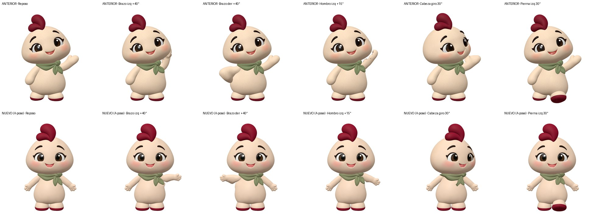
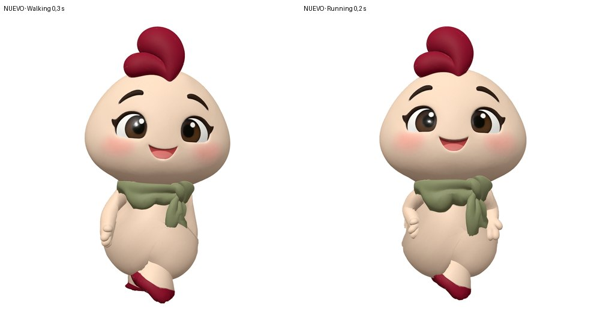

# 11 · Validación del nuevo modelo en A-pose (Meshy)

Fecha: 6-nov-2026. Rama: `fase-2b-validacion-apose`. Datos completos: `docs/data/rig-pruebas-apose.json`.

## 1. Archivo

| | |
|---|---|
| URL | <https://referencehome.es/images/rufi/Meshy_rufi.glb> (HTTP 200, 28 175 884 bytes, de nuevo **sin `Content-Type`**) |
| SHA-256 | `75cd1f47c4252c2ae3f679a1f704216dc732ab10436f77896eb29d07844ad5aa` |
| Copia intacta | `models/candidatos/apose/original/Meshy_rufi.glb` (Git LFS) |
| Versión web candidata | `models/candidatos/apose/rufi-apose.web.glb`: **609,9 KB**, 27 048 triángulos (`--ratio 0.12 --error 0.01`) |
| Modelo vigente | `models/rufi.web.glb` **no se ha sustituido** |

## 2. Contenido (`node tools/inspect-model.mjs`)

- 1 malla: 122 790 vértices, 225 406 triángulos. Sin shape keys.
- **Esqueleto: sí**, Mixamo, 24 huesos (los mismos nombres que el modelo anterior).
- **Animaciones: 2**, `Running` (0,63 s) y `Walking` (1,03 s). Ya no trae `Idle_11` ni `Idle_15`.
- Material y texturas iguales en estructura (JPEG 4096/4096/2048).
- Pose de reposo: A-pose simétrica, cabeza recta, brazos separados. Altura 1,61 m.

## 3. Identidad

Revisado con render texturizado frente a la imagen oficial: cresta de dos lóbulos, pañuelo verde con nudo, ojos abiertos con brillo, rubor, boca abierta sin dientes y suelas granate. Todo correcto.

**Discrepancia: las manos tienen dedos** (pulgar y dedos separados). `RUFI.md` define **manos tipo manopla, sin dedos**. Es una decisión de Reference Home: aceptarlo y actualizar `RUFI.md`, o regenerar con manoplas.

## 4. Método de prueba

Banco reproducible `tools/rig-bench/` (three.js 0.186.1 en Chromium), con las mismas pruebas en ambos modelos:

- **Regiones geométricas**, independientes de los pesos: cabeza (por encima del punto medio entre `Neck` y `Head`) y barriga (frente del tronco entre `Hips` y `Spine2`). Comprobadas visualmente.
- **Pesos**: porcentaje de vértices de cada región con peso de huesos ajenos.
- **17 movimientos controlados**, uno a uno, alrededor de ejes del mundo: brazo ±40° (subir, bajar, adelante), antebrazo 45°, hombro 15°, cabeza (girar 30°, asentir 20°, inclinar 20°), pierna 30° adelante y 20° lateral.
- **Medidas**: estiramiento de aristas (1,0 = intacto; el reposo frente a sí mismo da 1,0), desplazamiento de la cabeza al mover otras partes y estiramiento y desplazamiento de la barriga.

## 5. Resultados: nuevo frente a anterior

### Posición de los huesos (error de simetría izquierda/derecha)

| Par | Anterior | Nuevo |
|---|---|---|
| Mano | 0,393 m | **0,033 m** |
| Antebrazo | 0,211 m | **0,021 m** |
| Pie | 0,115 m | **0,024 m** |
| Muslo | 0,025 m | **0,001 m** |

### Pesos

| Región | Anterior | Nuevo |
|---|---|---|
| Cabeza con peso de brazos/hombros | 68,8 % de los vértices, peso máx. **1,0** | 38,3 %, peso máx. **0,34** (casi todo de los hombros) |
| Cabeza con peso de piernas | 0 % | 0 % |
| Barriga con peso de piernas | 14,9 %, máx. 0,89 | 30,5 %, máx. 0,87 |
| Barriga con peso de brazos/hombros | 98,5 %, máx. 0,95 | 94,3 %, máx. 0,79 |

### Movimientos controlados (modelo original sin optimizar)

| Prueba | Anterior: estiramiento máx. / p99,9 | Nuevo: máx. / p99,9 | Cabeza se mueve (anterior → nuevo) |
|---|---|---|---|
| Brazo izq. subir 40° | 31,9× / 3,27× | **3,9× / 1,34×** | 16,7 % → **0,10 %** |
| Brazo izq. bajar 40° | 33,6× / 3,93× | **4,6× / 1,22×** | 16,7 % → **0,10 %** |
| Brazo der. subir 40° | 30,7× / 3,02× | **13,4× / 1,95×** | 0,33 % → **0,09 %** |
| Antebrazo izq. 45° | 16,7× / 1,71× | **1,7× / 1,13×** | 10,4 % → **0 %** |
| Hombro izq. 15° | 17,1× / 2,17× | **3,6× / 1,27×** | 8,4 % → **0,91 %** |
| Cabeza girar 30° | 36,9× / 4,47× | **9,4× / 2,71×** | — |
| Cabeza asentir 20° | 8,9× / 1,90× | **3,4× / 1,52×** | — |
| Pierna izq. adelante 30° | 3,7× / 1,96× | 6,7× / **3,07×** | 0 % → 0 % |
| Pierna izq. lateral 20° | 2,2× / 1,63× | 3,5× / **2,33×** | 0 % → 0 % |

La versión optimizada (27 048 triángulos) da los mismos resultados (brazo izq. subir 40°: 2,4× / 1,50×; cabeza 0,10 %).



### Animaciones de Meshy en el nuevo modelo

| Clip | Estiramiento máx. | p99,9 |
|---|---|---|
| Walking | 21,3× | 6,1× |
| Running | 29,3× | 6,9× |

Siguen deformando (brazos recogidos, pañuelo retorcido, parte baja de la barriga arrugada). **No usar.**



## 6. Diagnóstico

| Pregunta | Respuesta |
|---|---|
| ¿Tiene esqueleto? | Sí, Mixamo de 24 huesos, simétrico y bien colocado |
| ¿Tiene animaciones? | Sí, 2 (Walking, Running), pero deforman la malla |
| ¿Se deforma la cabeza al mover los brazos? | **No.** Se desplaza como máximo 0,1 % de la altura (≈ 1,6 mm). Antes, 16,7 %. Al subir los **hombros** se mueve ≈ 1 % por el peso residual de los hombros en la cabeza |
| ¿La barriga permanece intacta? | **Con los brazos, sí** (se desplaza < 0,6 % y estira ≤ 1,35×; con el brazo derecho no cambia). **Con las piernas, no del todo**: con 30° de pierna la parte baja de la barriga se estira (p99,9 ≈ 3×). A simple vista se ve como un tirón suave, sin grietas, pero es peor que en el modelo anterior. **Al girar la cabeza** se arrastran el pañuelo y la parte alta del pecho (p99,9 2,7×) |
| ¿Es mejor que el anterior? | **Sí, claramente, en brazos, antebrazos, hombros y cabeza** (los movimientos que necesita una mascota de esquina). Peor en piernas |

**Conclusión:** el nuevo modelo es apto para animaciones de esqueleto controladas en la parte superior (saludo, respiración, inclinación de cabeza moderada). Para piernas y giros amplios de cabeza hay que retocar pesos.

## 7. Recomendaciones

1. **Decidir lo de las manos** (dedos frente a manoplas) antes de adoptar el modelo.
2. Retoque de pesos en Blender (poco trabajo comparado con el modelo anterior):
   - Quitar el peso de `LeftShoulder`/`RightShoulder` en la cabeza.
   - Pesar el pañuelo y la parte alta del pecho a `Spine2`, no a `Neck`/`Head`.
   - Suavizar la transición barriga–muslos (menos peso de `UpLeg` en la barriga).
3. Límites en el runtime mientras tanto: cabeza ±15° de giro, ±10° de asentir; piernas solo para saltitos pequeños.
4. No usar `Walking` ni `Running`; crear los clips del contrato (`greet_wave`, `idle_breathe`, `curious_tilt`…).
5. Cuando se apruebe: sustituir `models/rufi.web.glb` por `rufi-apose.web.glb` y mover el original a `models/original/`.

## 8. Cómo repetir las pruebas

```bash
python3 -m http.server 8000
# Banco (JSON):  http://localhost:8000/tools/rig-bench/?f=../../models/candidatos/apose/rufi-apose.web.glb
# Demostración:  http://localhost:8000/examples/visor-rig/
```
