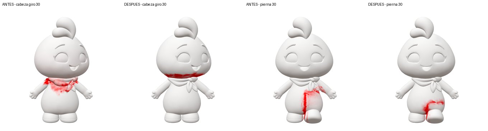
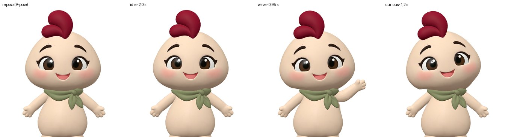
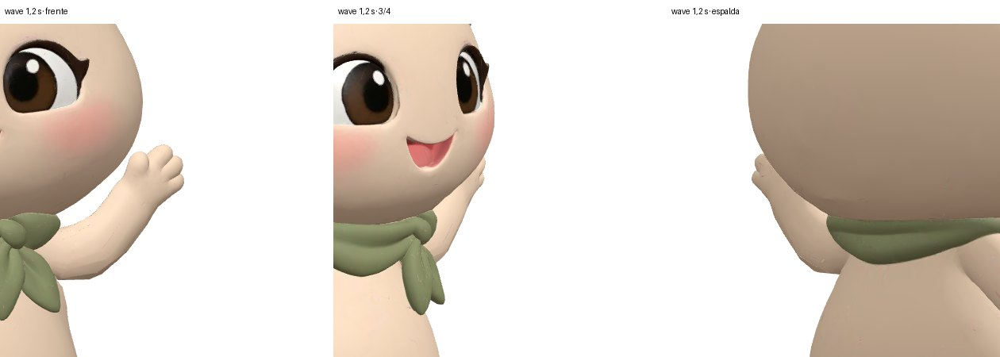

# 12 · Fase 3: perfeccionamiento del rig y animaciones

Fecha: 6-nov-2026. Rama: `fase-3-rigging` (sale de `fase-2b-validacion-apose`). Datos completos: `docs/data/rig-fase3.json`.

## 1. Decisiones aplicadas

- **Manos con dedos pequeños y redondeados**: aceptadas oficialmente; `RUFI.md` y `CLAUDE.md` actualizados.
- **Base de trabajo: el modelo A-pose** (`models/candidatos/apose/original/Meshy_rufi.glb`, intacto en Git LFS). No se ha regenerado.
- **Walking y Running no se usan**: el GLB final no los incluye (siguen en el original).

## 2. Resultado

| Archivo | Qué es |
|---|---|
| `models/rufi-animado.web.glb` | **GLB final optimizado: 556,2 KB**, 27 048 triángulos, texturas WebP 1024/1024/512, animaciones `idle`, `wave` y `curious` |
| `tools/rig-fix/fix-rig.mjs` | Corrección de pesos y creación de animaciones (reproducible, ≈ 2 s) |
| `examples/visor-animaciones/` | Visor interactivo con medición en vivo |

Regenerar:

```bash
node tools/rig-fix/fix-rig.mjs models/candidatos/apose/original/Meshy_rufi.glb build/rufi-rig.glb --report build/informe-pesos.json
node tools/optimize-model.mjs build/rufi-rig.glb models/rufi-animado.web.glb --ratio 0.12 --error 0.01
```

**Qué no se toca:** texturas, geometría, proporciones y pose de reposo (A-pose) son las del original. El script solo reescribe `JOINTS_0`/`WEIGHTS_0` y las animaciones. La optimización web reduce triángulos y convierte las texturas a WebP, igual que en la fase 2. El original sigue intacto.

## 3. Correcciones de pesos (`fix-rig.mjs`)

Las regiones se detectan sin usar los pesos: la cabeza, por encima del pivote de `Head`; el pañuelo, **por el color verde de su textura**; el resto, por geometría. Se pueden revisar con `tools/rig-fix/report-regions.mjs`.

| Regla | Qué corrige | Vértices |
|---|---|---|
| R1 | Cabeza 100 % `Head`: desaparece la influencia de los hombros | 44 784 |
| R2/R2b | El pañuelo copia los pesos de la piel que tiene debajo, sin cabeza, cuello ni brazos. Las puntas del nudo siguen a la barriga y el pañuelo nunca sigue a la cabeza | 23 752 |
| R3 | Franja de piel entre pañuelo y cabeza: se pesa por su posición relativa entre ambos sobre la superficie, no por la altura | 350 |
| R4 | Tronco sin cabeza/cuello. Hombro y brazo solo cerca de la axila. **La piel de los brazos no se toca** (se respeta la segmentación original de Meshy) | 16 054 |
| R5 | Muslos: solo en el propio muslo; en la barriga su influencia se retira gradualmente | 8 932 |
| R6 | Suavizado de pesos en las zonas de transición del tronco | — |
| R7 | Parte baja de la cabeza: de 60 % `Head` en la costura a 100 % a 8 cm, para repartir el giro | 404 |

Durante el trabajo se descartaron dos versiones que el banco de pruebas demostró que empeoraban:

- R4 por distancia al eje del brazo: quitaba el peso de manos y dedos (estiramiento de 72×).
- R3 por altura: rasgaba la unión del pañuelo al girar la cabeza (178×).

### Pesos: antes y después (porcentaje de vértices de la región con influencia ajena)

| | A-pose original | Corregido |
|---|---|---|
| Cabeza con peso de brazos/hombros | 38,3 % | **0,3 %** |
| Barriga con peso de piernas | 30,5 % | **1,5 %** |
| Barriga con peso de brazos/hombros | 94,3 % | **0,02 %** |

### Pruebas controladas (mismo banco que la fase 2; estiramiento máximo / percentil 99,9)

| Prueba | A-pose original | Corregido | Barriga (original → corregido) |
|---|---|---|---|
| Cabeza girar 30° | 9,4× / 2,71× | 18,6× / 2,59× | se desplaza 8,5 % → **0 %** |
| Cabeza asentir 20° | 3,4× / 1,52× | 8,8× / 1,36× | 6,3 % → **0 %** |
| Cabeza inclinar 20° | 6,6× / 2,04× | 8,5× / 1,62× | 2,7 % → **0 %** |
| Pierna izq. adelante 30° | 6,7× / 3,07× | 6,7× / 3,00× | estira 2,92× → **1,01×**; se desplaza 5,3 % → 1,6 % |
| Brazo der. subir 40° | 13,4× / 1,95× | **8,6× / 2,28×** | intacta |
| Brazo izq. subir 40° | 3,9× / 1,34× | 3,1× / 1,39× | intacta; cabeza 0,07 % |
| Hombro izq. subir 15° | 3,6× / 1,27× | **32,9× / 8,1×** | — |



Lectura de la tabla:

- **La cabeza ya no arrastra la barriga ni el pañuelo.** Al girarla, la deformación queda en la franja estrecha bajo la cabeza, oculta por el vuelo de la cabeza. Por eso el máximo puntual sube aunque el percentil 99,9 baje.
- **Las piernas ya no rasgan la barriga.** La deformación queda en la cadera.
- **Punto débil: el hombro.** Girar el hueso `Shoulder` estira la unión hombro–brazo. Las animaciones **no lo usan**.

## 4. Animaciones (sobre el esqueleto, sin movimiento CSS)

Se definen en `fix-rig.mjs` como giros alrededor de ejes del mundo, con curvas suavizadas, y se muestrean a 30 fps.

| Animación | Duración | Huesos | Qué hace |
|---|---|---|---|
| `idle` | 4,0 s, bucle sin salto | Spine2 (escala) + cuello y hombros (escala inversa), Head, ambos brazos | El pecho se expande un 1,5 % sin que crezcan cabeza ni brazos; balanceo de cabeza de ±1° y brazos de ±1,5° |
| `wave` | 3,2 s | LeftArm, LeftForeArm, LeftHand, Head | Sube el brazo izquierdo 52° (el de la imagen oficial), dobla el antebrazo 32° y saluda 3 veces (±14° antebrazo, ±10° mano). La cabeza acompaña 5° |
| `curious` | 2,6 s | Head | Inclina 10°, gira 6° y asiente ligeramente; vuelve a reposo |



### Verificación numérica (GLB optimizado, 25 instantes por animación, por región)

Estiramiento máximo / percentil 99,9:

| | Cara (ojos, boca, cejas) | Cabeza (incl. parte baja) | Pañuelo | Tronco | Brazos | Piernas |
|---|---|---|---|---|---|---|
| `idle` | **1,0002** | 1,09 / 1,01 | 1,67 / 1,16 | 1,22 / 1,07 | 1,19 / 1,04 | 1,00 |
| `wave` | **1,0001** | 1,57 / 1,16 | 1,99 / 1,23 | 2,15 / 1,64 | 4,71 / 2,46 | 1,00 |
| `curious` | **1,0001** | 2,29 / 1,31 | 1,96 / 1,17 | 4,02 / 2,18 | 2,22 / 1,29 | 1,00 |

Medida en vivo en el visor (peor instante de toda la animación, malla completa):

| | p99,9 | Máximo | Aristas > 2× |
|---|---|---|---|
| `idle` | 1,15× | 1,6× | 0 |
| `curious` | 1,50× | 3,9× | 16 |
| `wave` | 1,92× | 4,8× | 80 |
| Walking de Meshy (sin corregir) | 5,29× | 7,5× | 2 268 |

### Verificación visual

Renders texturizados de frente, en 3/4 y de espalda en los instantes de máxima amplitud:

- La cara, los ojos y el pañuelo no se deforman.
- En `curious` no hay quiebros en el borde inferior de la cabeza.
- En `wave` el brazo conserva su volumen.



## 5. Qué falta y requiere intervención manual en Blender

Las tres animaciones son utilizables y no deforman cabeza, ojos, pañuelo, barriga ni piernas. Para calidad de producción final quedan estos puntos:

1. **Axila en `wave`**: queda un pliegue leve bajo el brazo izquierdo cuando está arriba (es de donde sale el p99,9 = 1,92×). Arreglo: en Blender, una *shape key correctiva* `wave_axila` activada por la rotación de `LeftArm` (driver), o repintar los pesos de la axila entre `Spine2` y `LeftArm`. Estimación: 1–2 h.
2. **Unión hombro–brazo** (prueba de `Shoulder` de 15°: 32,9×): si en el futuro se anima el hombro (encoger, abrazar), repintar los pesos del hueso `LeftShoulder`/`RightShoulder` en Blender con *Weight Paint* y comprobar con el banco. Las animaciones actuales no lo mueven.
3. **Franja del cuello bajo la cabeza**: absorbe el giro de la cabeza y está oculta por su vuelo. Para giros de más de 15°, conviene revisarla en Blender. Mientras tanto, limitar la cabeza en el runtime a ±15° de giro y ±10° de inclinación.
4. **Expresiones faciales** (parpadeo, bocas): la malla no tiene shape keys. Hay que esculpirlas en Blender sobre esta base. Sin eso no hay `blink` ni `talk`.
5. **Nombres del contrato de la fase 1**: el esqueleto sigue siendo Mixamo y los clips se llaman `idle`/`wave`/`curious` (en la especificación, `idle_breathe`/`greet_wave`/`curious_tilt`). Correspondencia en `spec/rig-mapping-mixamo.json`. El validador sigue marcándolo como no conforme hasta decidir si se renombra o se actualiza el contrato.
6. **Walking/Running**: no corregidos (fuera de alcance). Habría que reanimarlos con amplitudes de hombro y pierna compatibles con estos pesos.

## 6. Comprobación

```bash
npm test                                                     # 16 pruebas
node tools/validate-glb.mjs models/rufi-animado.web.glb      # presupuesto: OK; contrato: ver §5.5
python3 -m http.server 8000
#   http://localhost:8000/examples/visor-animaciones/
#   http://localhost:8000/tools/rig-bench/?f=../../models/rufi-animado.web.glb
```
