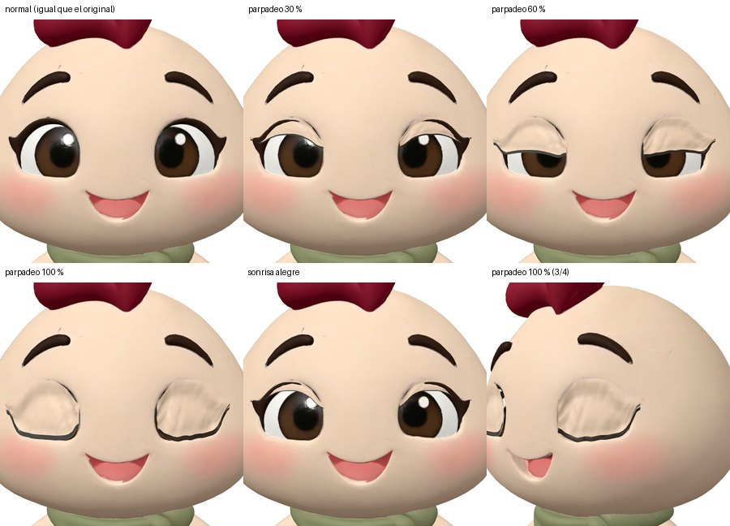
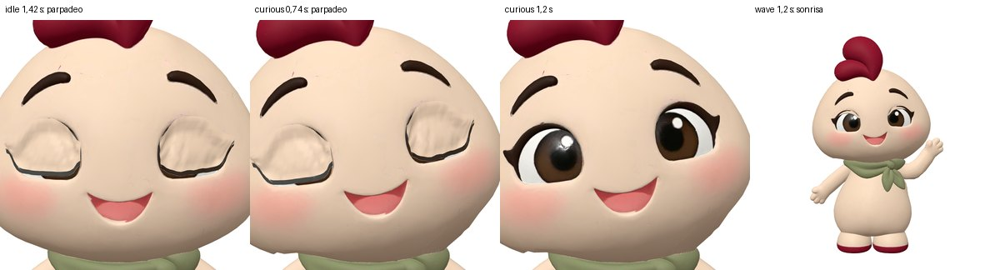
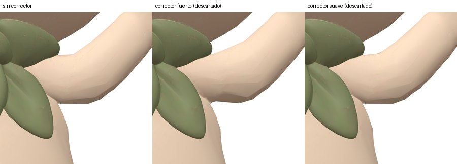

# 13 · Fase 4: expresiones faciales y acabado

Fecha: 6-nov-2026. Rama: `fase-4-expresiones` (sale de `fase-3-rigging`). Datos: `docs/data/rig-fase4-cara.json`.

## 1. Resultado

| Archivo | Qué es |
|---|---|
| `models/rufi-expresivo.web.glb` | **GLB final: 593,7 KB**, 28 104 triángulos. Morph targets `blink` y `smile`; animaciones `idle`, `wave`, `curious`, `blink` y `smile` |
| `models/blender/rufi-fase4.blend` | Mismo modelo en Blender (malla con shape keys, esqueleto de 24 huesos, 5 acciones) para el trabajo manual pendiente |
| `tools/face-rig/add-face.mjs` | Crea párpados, pestañas y sonrisa y añade los pesos de expresión a las animaciones |
| `examples/visor-expresiones/` | Visor para probar cada expresión y cada movimiento por separado o combinados |

Regenerar desde el original intacto:

```bash
node tools/rig-fix/fix-rig.mjs models/candidatos/apose/original/Meshy_rufi.glb build/rig.glb
node tools/optimize-model.mjs build/rig.glb build/rig-simpl.glb --ratio 0.12 --error 0.01 --no-meshopt
node tools/face-rig/add-face.mjs build/rig-simpl.glb build/rig-face.glb --report build/cara.json
node tools/optimize-model.mjs build/rig-face.glb models/rufi-expresivo.web.glb --ratio 1 --skip-textures --quantize-position 16
```

## 2. Cómo están hechas las expresiones (geometría real)

En el modelo de Meshy **los ojos están pintados en la textura**: no hay párpados que cerrar, y mover los vértices del ojo solo estiraría el iris pintado. Por eso:

- **`blink` (parpadeo):** se han añadido **párpados nuevos de geometría real**, uno por ojo. Cada uno es una rejilla de 24 × 10 que sigue el contorno del ojo y la profundidad de la superficie (envolvente suavizada), del color de la piel de encima del ojo. Lleva además una **línea de pestañas** de 12 mm que baja con el borde del párpado. Con el ojo abierto, cada columna se pliega en un solo punto del contorno superior: sus triángulos tienen área cero y no pintan nada.
- **`smile` (sonrisa alegre):** deformación de la malla de la cara. Las comisuras suben y se abren ligeramente y las mejillas suben; el centro de la boca no se mueve. En la expresión «sonrisa» se combina con el párpado al 18 % (ojos ligeramente entornados).
- **Normal:** pesos a cero, es decir, la cara original.

No hay ningún efecto CSS: todo son morph targets glTF aplicados por three.js antes del skinning.



## 3. Verificación

### Ojos abiertos idénticos al original

| Comparación | Resultado |
|---|---|
| Malla sin comprimir, con párpados (peso 0) frente a la misma sin párpados | **0 píxeles distintos** (diferencia máxima 0/255) |
| GLB final, párpados visibles frente a ocultos (frente, 3/4, primer plano del ojo) | **0 píxeles distintos** |
| GLB final frente a la misma base sin morph targets | PSNR 53,4 dB. Es la cuantización de la compresión: con morph targets cambia la rejilla, aunque a 16 bits la diferencia es subpíxel. No afecta a los ojos |

### Sin saltos entre estados

Todas las animaciones empiezan y terminan exactamente en reposo, con los pesos de expresión a 0: la diferencia máxima entre el primer y el último fotograma es 0, y respecto al reposo, 2,3·10⁻⁸. El visor encadena estados con un fundido de 0,25 s, y las expresiones manuales se interpolan de forma exponencial, sin cambios bruscos.

### Expresiones integradas en los movimientos

| Animación | Expresión |
|---|---|
| `idle` (4 s) | 2 parpadeos (1,30 s y 3,35 s), de 0,26 s cada uno |
| `wave` (3,2 s) | Sonrisa alegre mientras saluda y 1 parpadeo (1,9 s) |
| `curious` (2,6 s) | 1 parpadeo (0,62 s) y media sonrisa (25 %) |
| `blink` / `smile` | Expresiones sueltas |



### Deformación del cuerpo (visor, peor instante de cada movimiento)

| | p99,9 | Máximo | Aristas > 2× |
|---|---|---|---|
| `idle` | 1,11× (fase 3: 1,15×) | 1,4× | 0 |
| `curious` | 1,52× (1,50×) | 4,0× | 22 |
| `wave` | 1,86× (1,92×) | 4,8× | 70 (80) |

Cara, ojos, pañuelo y piernas siguen sin deformarse. Las restricciones de cabeza se mantienen: `curious` usa 10° de inclinación y 6° de giro, y `wave`, 5° y 4°.

## 4. Pliegue de la axila en `wave`: qué se intentó

| Intento | Resultado |
|---|---|
| Suavizado adicional de pesos en las axilas (regla R8 de `fix-rig.mjs`) | **Se conserva.** Prueba de hombro de 15°: 32,9× → 13,9×; `idle` y `wave` ligeramente mejor |
| Quitar el peso del tronco a la piel del brazo por distancia | Descartado: crea un borde nuevo (brazo derecho 28,9×) |
| Forma correctiva *delta mush* (12 iteraciones) activada con el brazo | Descartado: hace una muesca más marcada en la axila |
| Correctiva *delta mush* suave (4 iteraciones) | Descartado: no mejora de forma demostrable (brazos igual, tronco peor). Sigue disponible con `--corrector` |



**El pliegue leve de la axila sigue ahí** (solo se aprecia de cerca, de lado y con el brazo arriba). Corregirlo bien necesita un retoque esculpido a mano.

## 5. Trabajo manual pendiente en Blender (`models/blender/rufi-fase4.blend`)

### 5.1 Correctiva de la axila (prioritario, 1–2 h)

1. Abrir el archivo y seleccionar el armature. En *Pose Mode*, aplicar la acción `wave` e ir al fotograma 35 (1,15 s, brazo arriba).
2. Seleccionar `Mesh_0` → *Object Data* → *Shape Keys* → `+` → **New Shape from Mix**, renombrarla `wave_axila`. Activar *Shape Key Edit Mode* (icono de chincheta) para esculpir con el brazo levantado.
3. *Sculpt Mode*: pinceles **Smooth** (fuerza 0,3) y **Grab** solo bajo la axila izquierda, hasta que la piel pase del brazo al costado sin pliegue. No tocar el pañuelo ni el brazo por encima del codo.
4. Driver: en `wave_axila`, *Value* → *Add Driver* → variable *Transform Channel* del hueso `mixamorig:LeftArm`, rotación local, y expresión que valga 0 en reposo y 1 con el brazo arriba. Alternativa más sencilla: animar el valor en la acción `wave` (0 → 1 de 0 a 0,55 s, 1 hasta 2,55 s, 1 → 0 hasta 3,2 s).
5. Exportar con `blender/scripts/rufi_export_glb.py` y pasar `tools/optimize-model.mjs --ratio 1 --skip-textures --quantize-position 16`. Comprobar en `examples/visor-expresiones/`.

### 5.2 Acabado del párpado (opcional, 1–2 h)

El párpado usa un único color de piel. A muy corta distancia se distingue su borde como un «parche» liso sobre la piel con matices. Mejora:

1. Pintar en Blender (*Texture Paint*) una pequeña isla UV de piel con el degradado del párpado.
2. O reproyectar la textura de la piel de alrededor sobre las UV del párpado (*Bake* → *Diffuse*, desde la cara hacia el párpado).

### 5.3 Otros

- Más expresiones (sorpresa, «o», boca cerrada): esculpirlas como shape keys sobre la misma base, con los nombres del contrato (`mouth_o`, `mouth_closed_smile`…).
- Los nombres siguen la convención de las fases 3 y 4 (`blink`, `smile`, `idle`, `wave`, `curious`). Correspondencia con el contrato de la fase 1: `blink` = `blink_L` + `blink_R` (aquí un solo control para los dos ojos), `smile` ≈ `mouth_wide` + `eye_happy`.

## 6. Limitaciones

- Es un **parpadeo de párpado superior** que baja recto; no hay párpado inferior.
- La sonrisa es moderada a propósito, para no cambiar la expresión característica de Rufi.
- El pliegue de la axila en `wave` sigue pendiente (§5.1).
- El validador del contrato de la fase 1 sigue marcando no conformidad (esqueleto Mixamo, nombres de clips y shape keys).
